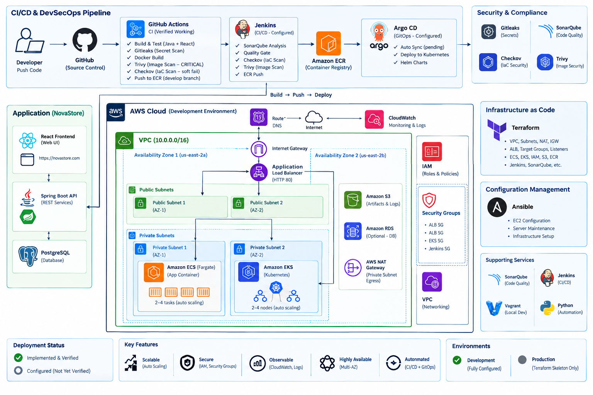

# NovaStore — Retail E-Commerce DevOps Modernization

**Full-Stack Application | AWS Cloud | Terraform | CI/CD | DevSecOps | Kubernetes | GitOps | Automation**

## Project Overview

NovaStore is a full-stack retail e-commerce application used to demonstrate how DevOps engineering practices modernize application delivery, infrastructure management, security, and operational reliability.

The application combines a **React storefront**, **Java 17 / Spring Boot REST API**, and **PostgreSQL database** with AWS infrastructure, automated delivery pipelines, container orchestration, configuration management, security scanning, and observability.

The engineering focus is not simply deploying an application. It is addressing the operational challenges that make enterprise applications difficult to release, scale, secure, and support.

## Business Problem

Traditional application environments face several recurring operational challenges:

| Business Challenge | Operational Impact |
|---|---|
| Manual deployments | Slow releases, inconsistent deployment steps, and higher risk of human error |
| Inconsistent server configuration | Applications behave differently across environments |
| Infrastructure provisioned manually | Configuration drift, difficult recovery, and slow environment creation |
| Limited application scalability | Performance and availability risks during increased demand |
| Security checks performed late | Vulnerabilities and exposed secrets reach later delivery stages |
| Poor monitoring and visibility | Engineers take longer to identify and investigate failures |
| Difficult release recovery | Failed changes increase downtime and operational risk |

**Engineering objective:** Build repeatable infrastructure and application delivery workflows with security controls, automation, operational visibility, and documented troubleshooting procedures.

## Engineering Solutions

| Engineering Area | Business Problem Addressed | Implementation |
|---|---|---|
| Application Engineering | Need for a deployable, testable application | React storefront, Java Spring Boot REST API, PostgreSQL |
| Infrastructure as Code | Manual provisioning and infrastructure drift | Terraform modules for AWS networking, compute, IAM, container platforms, and supporting services |
| Cloud Networking | Secure application access and workload isolation | AWS VPC, public/private subnets, routing, NAT Gateway, security groups, ALB |
| Container Platforms | Consistent deployments and application scaling | Docker, Amazon ECS/Fargate, Amazon EKS, Kubernetes |
| CI/CD | Slow and error-prone releases | GitHub Actions and Jenkins pipelines for builds, tests, scans, and deployment workflows |
| GitOps | Difficulty maintaining desired Kubernetes configuration | Argo CD and Helm for declarative deployment configuration and reconciliation |
| Configuration Management | Inconsistent server setup and repetitive administration | Ansible playbooks, EC2 dynamic inventory configuration, Bash, and Python |
| DevSecOps | Security issues discovered too late | Gitleaks, Trivy, Checkov, and SonarQube |
| Observability | Limited visibility into failures and performance | Amazon CloudWatch, Prometheus, and Grafana |
| Local Development | Differences between developer environments | Docker Compose and Vagrant |

## Architecture

[View full-size architecture diagram](docs/architecture/novastore-architecture.png)

The architecture illustrates the application, AWS infrastructure, CI/CD, container deployment, security, and monitoring components represented in the engineering work.

The repository contains both ECS/Fargate and EKS implementation paths. These represent platform options and engineering exercises; they should not be interpreted as proof that every component is currently running simultaneously.

## Engineering Implementation & Results

### 1. Application Engineering

- Built a React storefront backed by a Java Spring Boot REST API and PostgreSQL.
- Verified database connectivity, product retrieval, application health checks, and frontend/backend builds.
- Containerized the Java application using Docker and validated the local image build and runtime behavior.

### 2. AWS Infrastructure & Networking

- Developed reusable Terraform modules covering VPC networking, public/private subnets, routing, NAT Gateway, security groups, IAM, EC2, ALB, ECR, ECS/Fargate, and EKS.
- Designed infrastructure across two AWS Availability Zones, separating public-facing components from private workloads.
- Practiced infrastructure provisioning, configuration validation, troubleshooting, and teardown to manage cloud costs.
- Successfully initialized and validated the NovaStore Terraform development configuration.

### 3. CI/CD & Release Engineering

- Implemented GitHub Actions workflows for application builds, automated testing, and security checks.
- Developed Jenkins pipelines integrating Java builds, SonarQube, Docker, Amazon ECR, and security scanning.
- Configured container delivery workflows using Amazon ECR, ECS/Fargate, and Kubernetes deployment resources.
- Used pipeline checks to identify build, dependency, configuration, and container-security issues before later delivery stages.

### 4. Kubernetes & GitOps

- Implemented Kubernetes deployment configurations using EKS, Helm, and Argo CD.
- Defined application deployments, services, ingress, health probes, configuration, and scaling resources.
- Validated the Helm chart using `helm lint` and reviewed rendered Kubernetes resources.
- Documented troubleshooting for application connectivity, unhealthy deployments, and GitOps repository synchronization.

### 5. Ansible, Dynamic Inventory & Server Automation

**Business problem:** Manually configuring EC2 instances creates repetitive work, inconsistent environments, and a greater risk of configuration errors.

**Engineering approach:**

- Created Ansible configuration and playbooks for repeatable Linux server administration.
- Included an AWS EC2 dynamic inventory configuration to support discovering cloud instances rather than maintaining only a fixed list of IP addresses.
- Included a static inventory example for direct host-based administration.
- Used playbook-based workflows for server maintenance and configuration management.
- Combined Ansible with Bash and Python for infrastructure administration and operational automation.

**Engineering value:** Server configuration can be described as code, reviewed, repeated, and applied consistently instead of relying on undocumented manual steps.

**Implementation:** Used Ansible to configure and manage Linux servers, automating server maintenance and configuration tasks through repeatable playbooks. The repository includes AWS EC2 dynamic inventory configuration for discovering instances without manually maintaining server IP addresses.

**Explore the implementation:**

- [Ansible configuration](ansible/ansible.cfg)
- [AWS EC2 dynamic inventory](ansible/aws_ec2.yml)
- [Server maintenance playbook](ansible/playbooks/server-maintenance.yml)
- [Python EC2 automation script](scripts/list_ec2.py)

### 6. DevSecOps

- Integrated Gitleaks, Trivy, Checkov, and SonarQube into application and infrastructure engineering workflows.
- Investigated and remediated container and Java dependency vulnerabilities.
- Verified zero HIGH and CRITICAL findings in the final documented local Trivy image scan.
- Completed a successful GitHub Actions CI run with automated security checks.

**CI enforcement detail:** GitHub Actions blocks CRITICAL Trivy findings. Checkov currently runs in reporting mode (`soft_fail: true`), so its findings do not block the pipeline.

### 7. Observability & Operational Troubleshooting

- Worked with Amazon CloudWatch, Prometheus, and Grafana to investigate application and infrastructure health.
- Practiced interpreting metrics, logs, health checks, and deployment state during troubleshooting.
- Documented engineering investigations involving IAM, container images, Jenkins, Kubernetes networking, ALB connectivity, and GitOps.

### 8. Database Engineering

- Implemented PostgreSQL integration for the NovaStore application.
- Completed additional MySQL and MongoDB exercises covering relational queries and document-oriented data models.

## CI/CD and Security

The repository contains two delivery approaches:

**GitHub Actions:** Automated application testing, security scanning, and configured container publishing workflows.

**Jenkins:** Pipeline-based Java builds, code-quality analysis, container image creation, security checks, and deployment integration.

Security tools address different risks:

- **Gitleaks:** Detects exposed secrets.
- **Trivy:** Scans container images and dependencies for vulnerabilities.
- **Checkov:** Checks Infrastructure as Code for security misconfigurations.
- **SonarQube:** Supports code-quality and security analysis.

Pipeline configuration is included in:

- [GitHub Actions workflow](.github/workflows/ci.yml)
- [Jenkinsfile](Jenkinsfile)

## Infrastructure and Deployment

Terraform defines the AWS infrastructure using reusable modules and separate development and production environment configurations.

Kubernetes delivery resources are available through:

- [Terraform modules](terraform/modules/)
- [Helm chart](helm/java-app/)
- [Argo CD application](argocd/novastore-java.yaml)
- [Kubernetes manifests](kubernetes/java-app/)

**Deployment note:** AWS infrastructure is not currently running. Resources were shut down to avoid unnecessary cloud charges.

The repository uses example infrastructure identifiers in selected configuration files. A new deployment requires environment-specific AWS account settings, credentials, and configuration.

A successful CI run or Terraform validation does not establish that a live AWS deployment is currently available.

## Engineering Troubleshooting & Incident Response

NovaStore documents eight engineering troubleshooting investigations covering security, CI/CD, IAM, container delivery, Kubernetes networking, and GitOps.

### Featured Engineering Investigations

| Incident | Engineering Focus |
|---|---|
| [EKS Application Inaccessible Through ALB](docs/troubleshooting/06-eks-alb-application-connectivity.md) | ALB-to-Pod routing, Ingress, health checks, IAM, and subnet discovery |
| [Unhealthy Kubernetes Deployment](docs/troubleshooting/07-unhealthy-kubernetes-deployment.md) | Runtime health, readiness/liveness probes, service ports, and recovery |
| [Argo CD Synchronization Failure](docs/troubleshooting/08-argocd-gitops-synchronization.md) | Repository authentication, Git access, and desired-state reconciliation |

**[Explore all 8 engineering troubleshooting case studies →](docs/troubleshooting/README.md)**

The case studies distinguish confirmed configuration changes from diagnostic procedures and verification steps where historical runtime evidence is unavailable.

## Engineering Documentation & Evidence

- [Architecture diagram](docs/architecture/novastore-architecture.png)
- [Troubleshooting case studies](docs/troubleshooting/README.md)
- [Infrastructure as Code](terraform/)
- [Ansible automation](ansible/)
- [CI/CD workflows](.github/workflows/ci.yml)
- [Helm deployment configuration](helm/java-app/)

Screenshot links are intentionally omitted until verified screenshots are added to the repository.

## Project Status

| Component | Status |
|---|---|
| Application builds and tests | Verified during project work |
| Docker image build | Verified locally |
| GitHub Actions CI | Verified during project work |
| Terraform development configuration | Validation passed |
| Helm chart | Lint validation passed |
| AWS infrastructure and deployment workflows | Implemented/configured; no active live deployment |
| Ansible server configuration | Implemented and used to configure Linux servers |
| AWS EC2 dynamic inventory | Configuration included; live execution verification not yet documented |
| Engineering documentation | Published in repository; supporting screenshots not yet included |

**Portfolio scope:** This repository documents implemented engineering work, verified local checks, configured cloud workflows, and troubleshooting investigations. It does not represent a continuously running production service.
